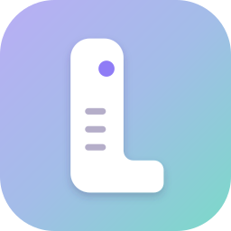
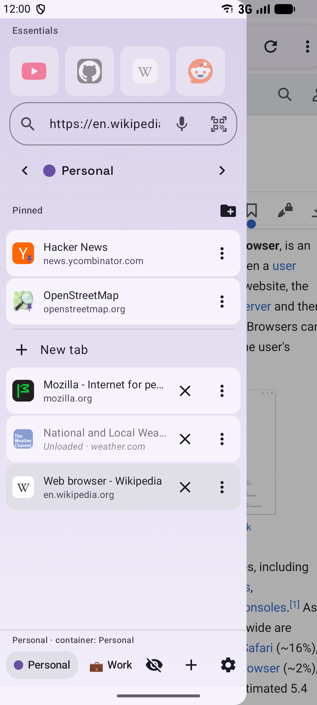
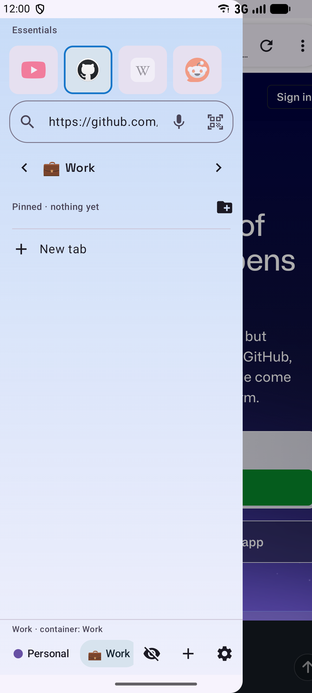
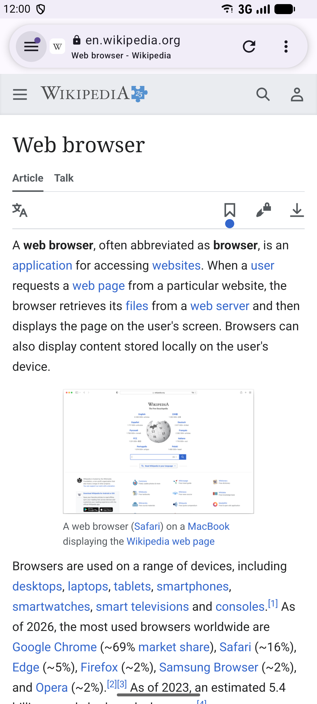
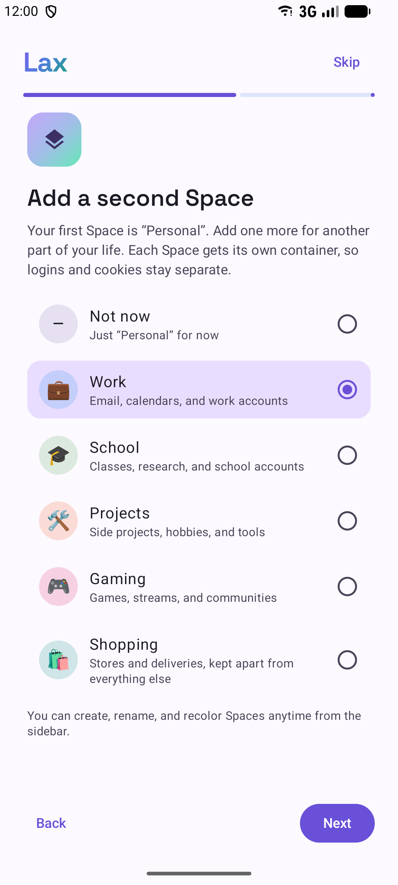
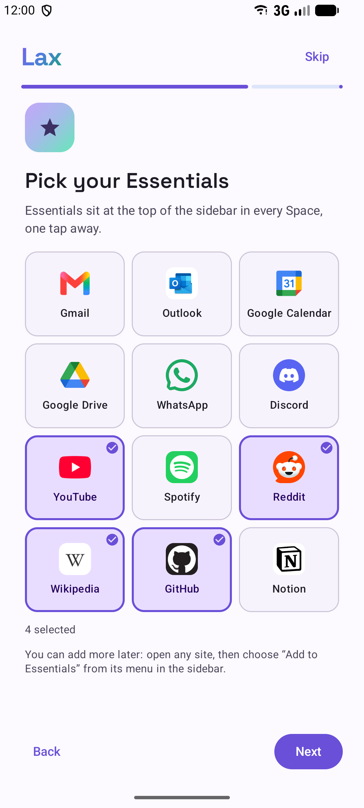

<div align="center">
  
  <h1>Lax</h1>
  <p>
    A web browser for Android based on Mozilla's GeckoView. Tabs are kept in a sidebar instead of
    a tab strip, and are grouped into Spaces, each with its own cookie container.
  </p>
</div>

## Contents

- [Screenshots](#screenshots)
- [Features](#features)
- [Download](#download)
- [Building](#building)
- [Documentation](#documentation)
- [License](#license)

## Screenshots

<p align="center">
  
  
  
  
  
</p>

## Features

- Vertical tab sidebar with Essentials (tabs shown in every Space), pinned tabs, folders and
  regular tabs. It can be placed on either side and stays docked on tablets.
- Spaces, each with a separate container for cookies, site storage and logins.
- Choose which Space links from other apps open in, or pick one each time from the share menu.
- Pinned tabs remember their starting page. Unused tabs are unloaded after a configurable time.
- Split view and link previews.
- Private tabs, which can be locked behind the screen lock when you leave the app. Enhanced
  Tracking Protection, HTTPS-only mode and Global Privacy Control.
- Firefox add-ons from addons.mozilla.org.
- Saved logins, stored encrypted on the device, with a password generator. Import them from the
  CSV file Firefox, Chrome or Bitwarden export, or export them the same way. Android autofill
  services also work.
- Bookmarks (with HTML import/export), history, downloads, reader view, translation, find in
  page, per-site zoom, installable web apps and Custom Tabs.
- Local backups, or backups to your own Nextcloud (by hand or daily), optionally with saved
  logins encrypted by a password you choose.
- Swipe on the address to switch tabs and Spaces; each direction can be set to another action.
- A search bar widget for the home screen, optionally tied to one Space.
- English and Spanish translations.

Lax has no telemetry. See [PRIVACY.md](PRIVACY.md) for what it stores and which servers it
contacts.

## Download

<p align="center">
  <a href="https://apps.obtainium.imranr.dev/redirect?r=obtainium://add/https://github.com/EzeZZap/lax-browser">
    
  </a>
</p>

Signed APKs are attached to each [GitHub release](../../releases):

- `arm64-v8a` for most phones
- `armeabi-v7a` for older 32-bit phones
- `x86_64` for emulators and Chromebooks

Lax can check this repository for new releases once a day and download and install them
(Android asks you to confirm). It's off until you turn it on during setup or in Settings > About;
leave it off if you use Obtainium. Android 8.0 or newer is required.

## Building

You need JDK 17 or newer (the JBR bundled with Android Studio works) and the Android SDK.

Update checks use the GitHub releases of the repository set in `laxUpdateRepo`
(`gradle.properties`).

```sh
./gradlew assembleDebug
./gradlew assembleRelease
./gradlew testDebugUnitTest lintDebug
```

APKs end up in `app/build/outputs/apk/<build type>/`. Android Studio also has run
configurations for both builds. Release signing is described in
[docs/RELEASING.md](docs/RELEASING.md).

Instrumented tests (database migrations, container isolation, UI) need a device or emulator:

```sh
./gradlew connectedDebugAndroidTest
```

## Documentation

- [docs/ARCHITECTURE.md](docs/ARCHITECTURE.md): how the code is organized
- [docs/RELEASING.md](docs/RELEASING.md): signing, versioning and publishing
- [docs/EXTENSIONS.md](docs/EXTENSIONS.md): add-on support

## License

Lax is licensed under the [Mozilla Public License 2.0](LICENSE).

It includes GeckoView (MPL 2.0), AndroidX and other libraries under the Apache License 2.0, and
the Space Grotesk font (SIL Open Font License 1.1). The full list is in the app under
Settings > About > Licenses. Site and add-on logos belong to their respective owners.
